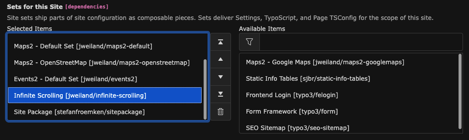
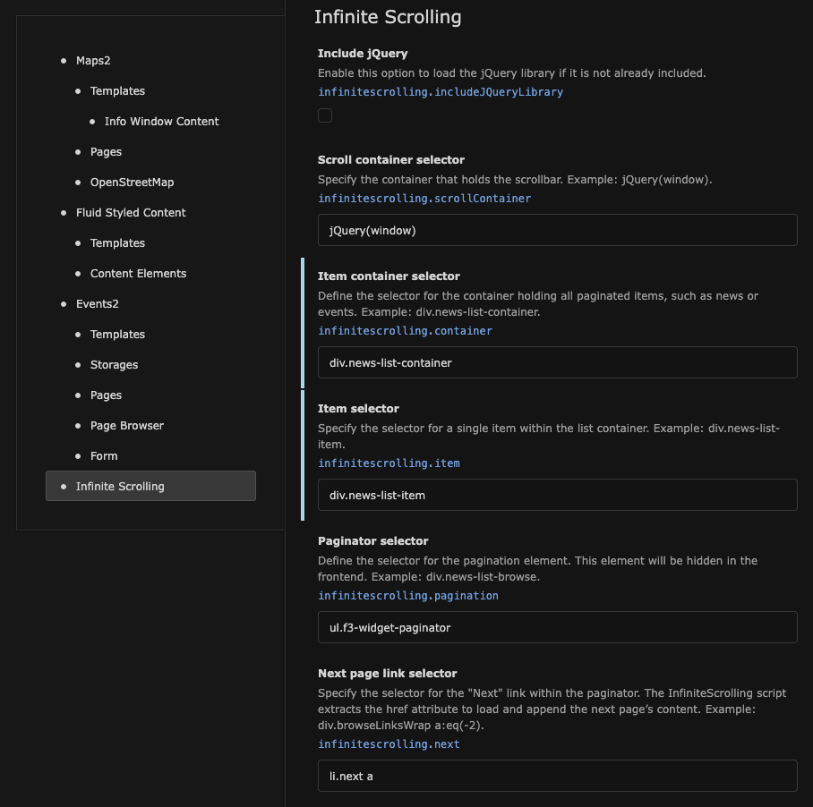
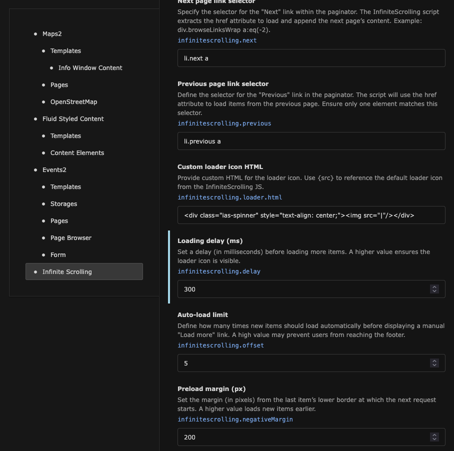

:navigation-title: Configuration

..  _configuration:

=============
Configuration
=============

..  _configuration-add-site-settings:

Add Site Settings
=================

Infinite Scrolling is a frontend extension that does not require a plugin.

To configure the extension, navigate to :guilabel:`Site Management -> Sites`
and add the :guilabel:`Infinite Scrolling` Site Set to your Site configuration.

    Adding the Infinite Scrolling Site Set

..  _configuration-site-settings:

Site Settings
=============

Go to :guilabel:`Site Management -> Settings`, select your Site configuration,
and scroll down to :guilabel:`Infinite Scrolling`.

    Configure the first section of Site Settings

..  confval:: Include jQuery
    :type: boolean
    :Default: false
    :Path: infinitescrolling.includeJQueryLibrary

    Enable this option to include the jQuery JavaScript library.

..  confval:: Scroll container selector
    :type: string
    :Default: window
    :Path: infinitescrolling.scrollContainer

    Define the scroll container. Use `window` to bind the scrolling to the
    browser window, or provide a jQuery selector for a scrollable element.

    Sample: `window`

..  confval:: Item container selector
    :type: string
    :Default: (none)
    :Path: infinitescrolling.container

    Specify the jQuery selector for the container holding all
    items (e.g., news or events) to paginate.

    Sample: `div.news-list-container`

..  confval:: Item selector
    :type: string
    :Default: (none)
    :Path: infinitescrolling.item

    Specify the jQuery selector for a single item within the list container.

    Sample: `div.news-list-item`

..  confval:: Pagination selector
    :type: string
    :Default: ul.f3-widget-paginator
    :Path: infinitescrolling.pagination

    Define the jQuery selector for the paginator. This selector will hide the
    paginator in the frontend.

    Sample: `div.news-list-browse`

..  confval:: Next page link selector
    :type: string
    :Default: li.next a
    :Path: infinitescrolling.next

    Define the jQuery selector for the "Next" link in the paginator. The
    href attribute will be used to load and append the next page’s content.

    Sample: `div.browseLinksWrap a:eq(-2)`

    Configure the second section of Site Settings

..  confval:: Previous page link selector
    :type: string
    :Default: li.previous a
    :Path: infinitescrolling.previous

    Define the jQuery selector for the "Previous" link in the paginator. The
    href attribute of this element will be used to retrieve items from the
    previous page. Ensure only one element matches the selector.

    Sample: `li.previous a`

..  confval:: Custom loader icon HTML
    :type: string
    :Default: 

    :Path: infinitescrolling.loader.html

    Customize the loader icon by specifying your own HTML. Use {src} to include
    the loader icon path, either the default one or the one set via
    "Custom loader icon path".

    Sample: `

`

..  confval:: Custom loader icon path
    :type: string
    :Default:
    :Path: infinitescrolling.loader.src

    Provide a custom path to a loader icon, e.g.
    `EXT:my_sitepackage/Resources/Public/Icons/spinner.gif`. Leave empty to use
    the default loader icon.

    Sample: `EXT:my_sitepackage/Resources/Public/Icons/spinner.gif`

..  confval:: Loading delay (ms)
    :type: int
    :Default: 0
    :Path: infinitescrolling.delay

    Set a delay (in milliseconds) before loading additional items. Increase
    this value to ensure the loader icon is visible longer.

    Sample: `5`

..  confval:: Auto-load limit
    :type: int
    :Default: 5
    :Path: infinitescrolling.offset

    Define how many times new items should be automatically loaded before
    displaying a manual "Load More" button. Avoid setting this too high to keep
    the footer accessible.

    Sample: `7`

..  confval:: Preload margin (px)
    :type: int
    :Default: 200
    :Path: infinitescrolling.negativeMargin

    Set the margin (in pixels) from the last item's bottom edge before the next
    request starts. A higher value loads items earlier.

    Sample: `130`

..  _configuration-ias-extensions:

IAS extensions
==============

Infinite AJAX Scroll ships several extensions. Each of them can be enabled or
disabled in the :guilabel:`IAS extensions` category of the Site Settings. Only
the JavaScript files of enabled extensions are loaded in the frontend.

..  confval:: Enable spinner extension
    :type: boolean
    :Default: true
    :Path: infinitescrolling.extension.spinner

    Shows the loader icon while new items are loaded. See
    "Custom loader icon HTML" and "Custom loader icon path".

..  confval:: Enable paging extension
    :type: boolean
    :Default: true
    :Path: infinitescrolling.extension.paging

    Keeps track of the page the visitor is currently viewing. Required by the
    history extension.

..  confval:: Enable trigger extension
    :type: boolean
    :Default: true
    :Path: infinitescrolling.extension.trigger

    Shows the "Load more items" and "Load previous items" links. See
    "Auto-load limit".

..  confval:: Enable history extension
    :type: boolean
    :Default: true
    :Path: infinitescrolling.extension.history

    Updates the URL while scrolling, so the back button of the browser and
    shared links lead to the current page. Requires the paging extension.

..  confval:: Enable "none left" extension
    :type: boolean
    :Default: false
    :Path: infinitescrolling.extension.noneLeft

    Shows a message below the last item when there are no more pages to load.
    The text is translated via the label `noneLeftItems` in
    `EXT:infinitescrolling/Resources/Private/Language/locallang.xlf`.

..  confval:: HTML of the "none left" message
    :type: string
    :Default: 
{text}

    :Path: infinitescrolling.noneLeft.html

    HTML of the message shown by the "none left" extension. Use {text} to
    insert the translated text.

..  _configuration-javascript-event:

Add your own IAS extensions
===========================

After Infinite AJAX Scroll has been initialized, the JavaScript event
`infinitescrolling:initialized` is dispatched on `document`. Its `detail`
contains the IAS instance (`ias`) and the configuration (`config`). Use it to
register further IAS extensions or callbacks in your own JavaScript, which has
to be loaded before the DOM is ready:

..  code-block:: javascript

    document.addEventListener('infinitescrolling:initialized', (event) => {
      event.detail.ias.on('rendered', (items) => {
        // e.g. re-initialize a lightbox for the newly loaded items
      });
    });
